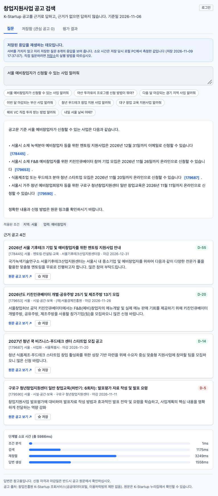
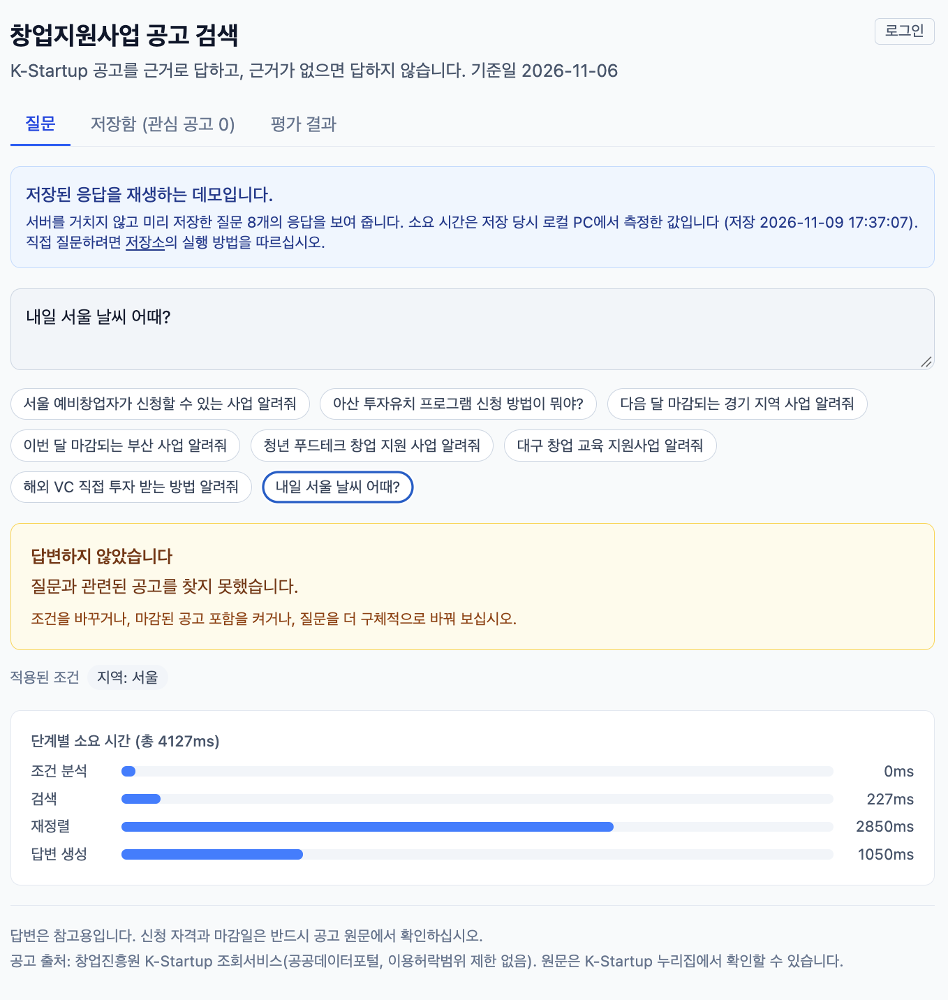

# grant-finder-rag

정부 창업지원사업 공고(K-Startup 공공데이터)를 대상으로 하는 **한국어 RAG**입니다. "서울 예비창업자가 신청할 수 있는 사업 알려줘"처럼 물으면 조건(지역, 업력, 마감 시기)을 질문에서 추출해 검색하고, **공고번호 출처가 붙은 답변**을 만듭니다. 근거가 없으면 답하지 않고 거절합니다.

모든 구성 요소를 **무료**로 쓰도록 만들었습니다. 임베딩과 리랭커는 로컬에서 돌리고, 답변 생성은 로컬 Ollama 또는 무료 한도의 Gemini/Groq를 씁니다.

## 데모

**[재생 데모 열기](https://ksunnyoo.github.io/grant-finder-rag/)**: 미리 저장한 질문 8개(조건 질문 6개, 거절 사례 2개)의 응답을 재생합니다. 서버 없이 동작하며 로그인이 필요 없습니다. **평가 결과** 탭에서는 검색 구성 비교와 답변 생성 평가, 해석의 한계를 볼 수 있습니다. 직접 질문하려면 아래 실행 방법으로 로컬에서 실행해야 합니다.

| 답변 (근거 공고 표시) | 거절 (공고에 없는 질문) |
|---|---|
|  |  |

## 진행 상태

| 구분 | 상태 |
|---|---|
| 수집, 정제, 색인 | 완료 |
| 검색(hybrid + 필터 + 리랭커), 답변 생성, 인용 검사, 거절 | 완료 (CLI) |
| 평가(골든셋 95문항, 구성 비교) | 완료 |
| FastAPI 서버, React 화면 | 완료 |
| GitHub Pages 재생 데모(백엔드 없이 저장된 응답을 재생) | 완료 |
| 선택 로그인, 관심 공고·질문 이력 저장(Supabase) | 완료 (선택 기능) |

## 동작 방식

~~~
[오프라인] 수집 → 정제·마스킹 → 사업 정보 연결 → 검색 문서 작성 → 임베딩(dense) + BM25(sparse) → Qdrant
[온라인]   질문 → 조건 추출 → hybrid 검색(RRF) + 필터 → 리랭커 → 거절 검사 → LLM 답변 → 인용 검사
~~~

- 임베딩: Ollama `bge-m3` (1024차원), 희소 검색: kiwipiepy 형태소 분석 + BM25
- 벡터 저장소: Qdrant 로컬 파일 모드 (서버 불필요)
- 리랭커: `BAAI/bge-reranker-v2-m3`
- 답변 생성: 로컬 개발은 Ollama `qwen3:8b`, 배포는 Gemini → Groq 순서로 시도하는 `FallbackLLM`

### 설계 결정

- **필터 규칙:** 지역은 선택한 지역과 "전국"을 함께 허용합니다. 대상, 업력, 연령은 값이 비어 있는 공고도 통과시키고 화면에 "미기재"로 표시합니다. 값을 추측해서 채우지 않습니다. 마감된 공고는 기본으로 제외하며, 기준일은 `AS_OF_DATE`로 고정합니다.
- **거절:** (1) 필터 후 후보가 없으면 거절, (2) 질문에서 조건이 추출되지 않았고 리랭커 최고점이 `REFUSE_THRESHOLD` 미만이면 거절, (3) LLM이 `[근거 없음]`을 출력하면 거절, (4) 재생성 후에도 유효한 인용이 없으면 거절합니다.
- **문서 구성:** 공고 1건을 검색 문서 1개로 만들고 나누지 않습니다. 본문 평균이 138자로 짧고(PRD), 검색 문서 평균은 493자입니다(E-003). 본문은 2,000자까지만 넣습니다. 나누는 방식과 비교한 실험은 하지 않았습니다.
- **인용:** 답변 문장 끝에 `[공고번호]`를 붙이게 하고, 검색 결과에 없는 번호는 제거합니다.
- **LLM 전환:** 429, 5xx, 시간 초과, 연결 실패일 때만 다음 공급자로 넘어갑니다. 같은 공급자를 재시도하지 않고, API 키를 바꿔 우회하지도 않습니다.
- **분야 필터:** 질문 속 일반 단어("글로벌" 등)가 분야 필터로 오인되어 정답이 사라지는 문제가 평가에서 확인되어, 문장에서 분야를 자동 추출하는 기능은 끄고 화면 선택으로만 지정하기로 했습니다.

## 평가 결과

자세한 내용과 한계는 [`docs/EVALUATION.md`](docs/EVALUATION.md)에 있습니다. 기준일 2026-11-06, 마감 전 공고 214건, 상위 5개 기준입니다.

**쉬운 질문 (제목을 거의 그대로 사용, lookup 15 + 조건 질문 27)**

| 구성 | lookup Hit@5 | lookup MRR | 조건 질문 정밀도 |
|---|---|---|---|
| C0 dense | 1.00 | 0.84 | 0.00~0.08 |
| C1 + hybrid | 1.00 | 0.83 | 0.00~0.08 |
| C2 + 필터 | 1.00 | 1.00 | 1.00 |
| C3 + 리랭커 | 1.00 | 1.00 | 1.00 |

**어려운 질문 (제목 없이 기관+분야 또는 본문 단어로 질문, 15문항)**

| 구성 | Hit@5 | MRR | 중앙 지연 |
|---|---|---|---|
| C0 dense | 0.47 | 0.20 | 36ms |
| C1 + hybrid | 0.47 | 0.32 | 137ms |
| C2 + 필터 | 0.87 | 0.79 | 198ms |
| C3 + 리랭커 | 0.93 | 0.85 | 3,144ms |

**의미 같은 질문 (제목의 핵심 단어 없이 뜻만 같게 바꾼 질문, 15문항)**

| 구성 | Hit@5 | MRR | 중앙 지연 |
|---|---|---|---|
| C0 dense | 0.67 | 0.44 | 38ms |
| C1 + hybrid | 0.73 | 0.49 | 150ms |
| C2 + 필터 | 0.93 | 0.74 | 209ms |
| C3 + 리랭커 | 0.93 | 0.93 | 3,030ms |
| F-dense (dense + 필터) | 0.80 | 0.80 | 70ms |
| F-sparse (BM25 + 필터) | 0.73 | 0.58 | 173ms |

이 세트에는 지역·대상 조건이 없어 필터의 효과는 마감 공고 제외뿐입니다. 15문항 중 1문항(P009)은 비슷한 공고가 여럿이라 정답이 하나로 정해지지 않으며, 모든 구성이 놓쳤습니다.

**답변 생성 (LLM, 35문항 표본):** 범위 밖 질문 8개 중 8개 거절, 답할 수 있는 질문 27개 중 1개 오거절, 답변 26개 모두 출처 포함.

### 해석과 한계

- 필터의 효과는 분명합니다. 다만 정답을 마감 전 공고로 정했기 때문에, 마감 공고를 제외하는 규칙 자체의 효과가 섞여 있습니다.
- 리랭커는 어려운 질문에서 1문항을 더 맞혔지만 15문항 표본에서는 우연과 구분되지 않고, 응답이 약 3초 느려집니다. 거절 판단에 쓰는 점수를 만들기 때문에 유지합니다.
- **hybrid 효과(같은 필터 조건, 15문항씩 세 세트):** 단어 일치에 유리한 두 세트(어려운 질문, 희귀 단어 질문)에서는 BM25 단독(Hit@5 0.87, 0.87)이 hybrid와 같거나 순위가 더 높았고, dense만 쓸 때보다는 hybrid가 낫습니다(Hit@5 어려운 질문 0.73→0.87, 희귀 단어 질문 0.53→0.87). 뜻만 같고 단어가 다른 질문에서는 반대로 dense(MRR 0.80)가 BM25 단독(MRR 0.58)보다 낫고, hybrid는 정답을 가장 많이 찾았습니다(Hit@5 0.93). 한쪽 방식만 놓친 5문항을 hybrid가 모두 찾았습니다. 질문 설계에 따라 dense와 BM25의 우열이 뒤집히므로 어느 한쪽이 낫다고 결론 내리지 않고, 서로의 약점을 보완하는 hybrid를 유지합니다. 표본이 작아(1문항 6.7%p) 통계적 결론은 아닙니다. 자세한 표는 [`docs/EVALUATION.md`](docs/EVALUATION.md) E-012, E-014에 있습니다.
- 쉬운 질문 평가는 검색 대상이 214건뿐이고 제목을 그대로 쓰므로 변별력이 낮습니다.
- 범위 밖 질문 8개 중 7개는 주제가 완전히 다른 쉬운 질문입니다. 거절 정확도 100%를 일반화할 수 없습니다.
- 인용 비율은 출처가 붙었는지만 보며, 문장이 근거와 맞는지는 측정하지 않았습니다.
- 거절 기준 점수(0.05)는 16개 질문으로 정한 잠정값입니다.
- 평가 정답은 시스템과 같은 조건 해석으로 계산했으므로 조건 준수만 보여 주고 검색 품질을 증명하지 않습니다.

## 알려진 한계

- 공고의 구조화된 지역 값이 본문과 다른 경우가 있습니다(예: 본문은 경기·인천인데 지역 값은 전국). 값을 고치지 않고 그대로 씁니다.
- 통합공고 2,098건은 사업 소개가 연결되지 않았고, 22,436건은 제외 대상 문구가 없습니다.
- 첫 질문은 리랭커 모델 로딩 때문에 느립니다. 일반 응답은 6~18초이며 대부분 리랭커와 LLM 호출 시간입니다.
- Gemini/Groq는 무료 한도가 있고 모델 이름이 바뀝니다. 모델을 찾지 못하는 오류(404)는 설계상 다음 공급자로 넘어가지 않습니다. 무료 한도의 입력은 공급자가 서비스 개선에 쓸 수 있으므로 개인정보를 보내지 않습니다.
- 전체 공고 데이터는 저장소에 포함하지 않습니다(재생 데모용 응답 8건의 발췌와 원문 링크만 포함). 본인의 K-Startup API 키로 직접 수집해야 합니다. 데이터셋의 이용허락범위는 "제한 없음"입니다(공공데이터포털 확인).
- 답변은 참고용입니다. 신청 자격과 마감일은 반드시 공고 원문에서 확인해야 합니다.
- 업종이나 주제만 짧게 말하는 질문(예: "제조업 지원사업 알려줘")은 리랭커 점수가 기준(0.05)보다 낮아 거절될 수 있습니다. 같은 주제에 "스타트업"을 붙인 질문은 통과했고, 화면에서 분야를 선택해도 통과했습니다(E-017). 조건이 있으면 점수 기준은 적용하지 않고 LLM이 판단합니다.

## 실행 방법

필요한 것: Python 3.11, [uv](https://docs.astral.sh/uv/), [Ollama](https://ollama.com/), K-Startup 공공데이터 API 키

~~~bash
uv sync
ollama pull bge-m3
ollama pull qwen3:8b
cp .env.example .env   # 키와 모델 이름을 채웁니다
~~~

데이터 준비 (오프라인, 한 번만):

~~~bash
uv run python scripts/collect_kstartup.py
uv run python -m grant_finder_rag.ingestion.build_notices
uv run python -m grant_finder_rag.ingestion.link_business
uv run python -m grant_finder_rag.ingestion.compose
uv run python -m grant_finder_rag.ingestion.index
~~~

질문하기:

~~~bash
uv run python -m grant_finder_rag.cli ask "서울 예비창업자가 신청할 수 있는 사업 알려줘" --providers gemini
uv run python -m grant_finder_rag.cli search "아산 투자유치" --mode hybrid -k 5
~~~

서버와 화면 실행 (Ollama가 켜져 있어야 합니다):

~~~bash
LLM_PROVIDER_ORDER=gemini,groq uv run uvicorn grant_finder_rag.api.app:app --port 8000
cd web && npm install && npm run dev   # http://localhost:5173
~~~

- API: `POST /api/ask`, `GET /api/meta`, `GET /api/health`. 요청과 응답 필드는 camelCase이고 오류는 `{"error": {"code", "message"}}` 형식입니다
- 서버를 켜 둔 동안에는 Qdrant 파일을 다른 프로그램(`cli`, `run_eval`)이 열 수 없습니다
- 재생 데모 다시 만들기: 서버를 끄고 `uv run python scripts/export_demo.py` 실행 후 `cd web && npm run build:demo`

평가와 테스트:

~~~bash
uv run python scripts/build_golden.py              # 쉬운 질문 -> data/golden/golden.jsonl
uv run python scripts/build_golden_hard.py         # 어려운 질문
uv run python scripts/build_golden_rare.py         # 희귀 단어 질문
uv run python scripts/build_golden_paraphrase.py   # 의미 같은 질문
uv run python scripts/run_eval.py --skip-e2e       # 쉬운 질문 세트로 검색 구성 비교 (서버를 끈 상태에서)
uv run python scripts/run_eval.py --golden data/golden/golden_hard.jsonl --skip-e2e
uv run python scripts/export_eval.py               # 데모 평가 탭용 web/public/demo/eval.json 생성
uv run pytest
uv run ruff check .
(cd web && npm test)                     # 웹 단위 테스트
~~~

주요 환경 변수: `KSTARTUP_API_KEY`, `GEMINI_API_KEY`, `GROQ_API_KEY`, `LLM_PROVIDER_ORDER`, `AS_OF_DATE`, `REFUSE_THRESHOLD`

## 문서

- [`docs/PRD.md`](docs/PRD.md): 요구사항과 일정
- [`docs/SDD.md`](docs/SDD.md): 설계
- [`docs/EVALUATION.md`](docs/EVALUATION.md): 실험과 평가 기록 (측정 조건과 한계 포함)

## 선택 로그인과 저장함

로그인하지 않아도 모든 기능을 쓸 수 있습니다. 로그인하면 관심 공고와 질문 이력을 계정에 저장해 다른 기기에서도 볼 수 있습니다.

| 구분 | 저장 위치 |
|---|---|
| 로그인 안 함 | 이 브라우저(localStorage)에만 저장 |
| 로그인함 | 내 계정(Supabase). 로그인할 때 브라우저에 있던 항목을 한 번 옮기고 중복은 넣지 않음 |

- 로그인은 이메일 링크 방식이며 비밀번호가 없습니다.
- 보안: 화면 코드에는 공개용(publishable) 키만 들어갑니다. 테이블은 행 단위 보안(RLS)으로 본인 행만 읽고 쓸 수 있습니다. `service_role` 키와 DB 비밀번호는 사용하지 않습니다.
- 한계: 무료 기본 메일은 시간당 발송 수가 적어 `email rate limit exceeded`가 나올 수 있습니다. 무료 프로젝트는 약 7일간 사용이 없으면 일시 중지됩니다. 로그인 없이도 모든 기능이 동작하므로 데모에는 영향이 없습니다.
- 배포 사이트와 로컬 주소는 서로 다른 출처라 로그인 상태와 브라우저 저장 항목이 이어지지 않습니다.

설정(직접 실행할 때):

1. Supabase 무료 프로젝트에서 `bookmarks`, `history` 테이블과 RLS 정책을 만듭니다.
2. `web/.env.local`에 `VITE_SUPABASE_URL`, `VITE_SUPABASE_PUBLISHABLE_KEY`를 넣습니다(git에 올라가지 않음).
3. GitHub Pages 배포는 저장소 Settings → Secrets and variables → Actions → **Variables**(Repository variables)에 같은 이름 두 개를 등록하고, Supabase Authentication → URL Configuration의 Redirect URLs에 배포 주소를 추가합니다.

## AI 협업 방식과 검증

AI가 작성한 초안을 그대로 쓰지 않고, 아래 순서로 확인한 뒤 고쳤습니다.

- **요구사항:** 코드를 요청하기 전에 `docs/PRD.md`, `docs/SDD.md`에 범위와 입출력, 오류 처리를 먼저 적었습니다. 문서에 없는 기능은 문서를 먼저 고친 뒤 구현합니다(`CLAUDE.md`).
- **검증:** `pytest`(Fake Port 사용), `ruff`, `biome`, 골든셋 95문항 평가, 환경 변수 없이 처음부터 실행해 보는 확인. `main`에 올릴 때마다 GitHub Actions가 pytest, ruff, biome, 웹 단위 테스트(vitest, 조건 검증 함수 8개), 웹 빌드를 자동으로 실행합니다(`.github/workflows/ci.yml`).
- **기록:** 실험과 오류는 실행 일시와 함께 `docs/EVALUATION.md`에 남겼습니다.

초안을 고친 사례입니다.

| 사례 | 초안의 문제 | 어떻게 발견했는가 | 수정 |
|---|---|---|---|
| 거절 기준 기본값 (E-015) | 코드의 `REFUSE_THRESHOLD` 기본값이 `0`(기준 꺼짐)이었고, 평가는 환경 변수로만 0.05를 지정했습니다 | 데모 응답을 다시 저장하다가 거절되어야 할 질문(최고점 0.003)이 답변되는 것을 확인했습니다 | 기본값을 0.05로 통일하고 데모를 다시 저장했습니다. 환경 변수 없이 처음부터 실행하는 검증을 추가했습니다 |
| 이력 중복 저장 (E-016) | 로그인 후 브라우저 항목을 계정으로 옮기는 단계가 중복 실행될 수 있었습니다 | 로그인하면 이력이 2건씩 들어갔습니다 | 계정에 같은 질문과 시각이 있으면 넣지 않고, `navigator.locks`로 탭 동시 실행을 막고, 화면에서도 중복을 제거했습니다 |
| 오류 표시 (커밋 e527d62) | 저장함 오류 표시가 탭을 옮겨도 남아 있었습니다 | 탭을 바꿀 때 지우는 것이 적절한 동작인지 검토했습니다 | 탭 전환 시 오류를 초기화하도록 바꿨습니다 |
| 분야 자동 추출 (E-009) | 질문 속 일반 단어("글로벌")가 분야 필터가 되어 정답 공고를 제외했습니다 | 골든셋 평가에서 한 문항이 실패해 원인을 추적했습니다 | 분야 자동 추출을 기본으로 끄고 화면 선택으로만 지정합니다. 골든셋을 보고 고친 것이라 개선 수치는 낙관적입니다 |

거절 기준 0.05는 16개 질문의 점수 분포(답변 가능 최저 0.223, 답변 불가 최고 0.005)로 정한 잠정값입니다(E-006). 조건이 추출된 질문은 정상이어도 0.035가 나와 점수 기준을 적용하지 않습니다.

## 요청 로그와 요약

로컬 서버를 실행하면 `/api/ask` 요청마다 `logs/requests.jsonl`에 한 줄이 기록됩니다(`logs/`는 git 제외). 질문 내용은 남기지 않고 글자 수만 남깁니다.

- 기록 항목: 시각, 질문 글자 수, 거절 여부와 이유, LLM 공급자, 단계별 시간(ms), 출처 수, 오류 코드
- 요약: `uv run python scripts/summarize_logs.py`로 요청 수, 거절 이유별 횟수, 공급자별 횟수(Gemini에서 Groq으로 넘어간 횟수 확인), 응답 시간 p50·p95, 오류 코드별 횟수를 봅니다.
- 한계: 서버 안에서 잰 시간이며 처리 순서 대기는 포함하지 않습니다. 배포된 데모는 정적 재생이라 기록 대상이 아닙니다.

## 라이선스

코드는 MIT 라이선스입니다(`LICENSE` 파일). 공고 데이터는 저장소에 포함하지 않으며, 이용 조건은 "알려진 한계"의 데이터 항목을 참고하십시오.
